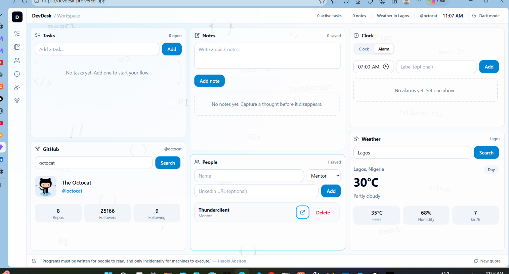

# DevDesk

A local-first developer workspace dashboard. Everything you need for the day sits on one screen, in docked panels that stay put while you work: tasks, notes, contacts, alarms, weather and a GitHub lookup.

**Live demo:** [devdesk-pro.vercel.app](https://devdesk-pro.vercel.app)



## Features

- **Tasks.** Add, complete and delete tasks. Deleting shows a 5-second Undo toast instead of removing things permanently on one click.
- **Notes.** A compact list of previews. Click a note to read and edit it in a modal, so the panel never grows taller as you add more.
- **People.** Save contacts with a role (Recruiter, Mentor, Teammate, Other) and an optional LinkedIn link that opens in a new tab.
- **Clock and Alarm.** A live clock plus alarms with a sound and a browser notification when one goes off.
- **Weather.** Search any city and see temperature, conditions, humidity and wind.
- **GitHub profile.** Look up any GitHub user. Results are cached for 10 minutes, and the last saved result is shown if GitHub's rate limit is reached.
- **Quote bar.** A programming quote in the status bar, with a button for a new one.
- **Dark and light mode**, remembered between visits.
- **Rail navigation.** The icons on the left jump to a panel and put your cursor in its first input.

## How it behaves

- **Docked layout.** On wide screens the page never scrolls. Each panel has a fixed place and scrolls inside itself. Below 1024px the panels stack into a single scrolling column.
- **Local-first.** All data is saved in your browser's `localStorage`. There is no account and no server.
- **Live sync between panels.** The counts in the top bar and panel headers update the moment you change something, using a small custom `useLocalStorage` hook that shares changes across components.

## Tech stack

| Area | Choice |
| --- | --- |
| UI | React 19, TypeScript |
| Build tool | Vite |
| Styling | Tailwind CSS v4 |
| Icons | lucide-react |
| Weather data | [Open-Meteo](https://open-meteo.com) (no API key needed) |
| GitHub data | GitHub REST API (unauthenticated) |
| Hosting | Vercel |

## Getting started

You need Node.js 20 or newer.

```bash
git clone https://github.com/DrSeed-dev/devdesk.git
cd devdesk
npm install
npm run dev
```

Then open the address Vite prints, usually `http://localhost:5173`.

### Scripts

| Command | What it does |
| --- | --- |
| `npm run dev` | Start the development server |
| `npm run build` | Type-check, then create a production build in `dist/` |
| `npm run preview` | Preview the production build locally |
| `npm run lint` | Run ESLint |

## Project structure

```text
src/
  components/
    layout/    Sidebar, TopBar, StatusBar, PanelMeta, CodeBackground
    ui/        Reusable pieces: Button, Panel, Modal, SegmentedControl, ThemeToggle
    widgets/   Todo, Notes, Contacts, Weather, GitHub, Clock (with clock/ sub-panels)
  context/     ToastProvider for undo toasts
  hooks/       useLocalStorage, useTheme, useToast
  lib/         API helpers, storage keys, quotes, formatting
  types/       Shared TypeScript types
```

## Accessibility

- Every input has a label, visible or screen-reader only.
- Loading and error states are announced to screen readers through live regions.
- All buttons show a clear keyboard focus ring.
- Modals close with the Escape key.
- Entrance animation respects the system "reduce motion" setting.

## Known limitations

- Data lives in one browser only. Clearing site data, or opening the app on another device, starts you from empty.
- Alarms only ring while the DevDesk tab is open, because they run in the page rather than as a background service.
- GitHub allows 60 unauthenticated requests per hour per network, so heavy searching can briefly hit the limit.
- LinkedIn offers no public lookup API, so contacts are saved by hand rather than fetched.

## Roadmap

- [ ] Export and import a backup file of your data
- [ ] Timer and stopwatch in the Clock panel
- [ ] Ctrl K command palette
- [ ] Mobile layout polish

## Author

Built by [DrSeed-dev](https://github.com/DrSeed-dev).
